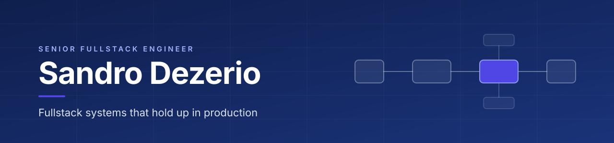

  

  <a href="https://blog.sandrodezerio.dev"><b>Blog</b></a> &nbsp;·&nbsp;
  <a href="https://www.linkedin.com/in/sandro-dezerio/"><b>LinkedIn</b></a> &nbsp;·&nbsp;
  <a href="https://dev.to/sandrosd"><b>dev.to</b></a> &nbsp;·&nbsp;
  <a href="mailto:sdezerio@gmail.com"><b>Email</b></a>

## About

Nine years building web products, mostly in JavaScript and TypeScript. I work as a fullstack engineer on a global retail e-commerce platform: React and Next.js on the front, Node and GraphQL on AWS behind it. Before that I built fintech backends with NestJS microservices.

The thread through most of this work is reliability. Third-party APIs, queues and AI steps fail in predictable ways, and I like designing systems that expect it: retries with backoff, idempotency, dead-letter queues, structured logs.

I also review code, mentor teammates and I am working toward a tech lead role. Based in Buenos Aires, Argentina. Open to senior and lead fullstack roles, remote.

## Writing

I write short, practical posts with small examples you can run in one command.

**Reliable background jobs in Node.js, from zero** (10-part series)

1. [What is a job queue, and why does my API need one?](https://blog.sandrodezerio.dev/what-is-a-job-queue/)
2. [How many jobs should a Node.js queue run at once?](https://blog.sandrodezerio.dev/node-job-queue-concurrency/)

More parts are on the way. Posts are published on the [blog](https://blog.sandrodezerio.dev) and mirrored on [dev.to](https://dev.to/sandrosd).

## Stack

<table>
  <tr>
    <td><b>Languages</b></td>
    <td>
      
      
    </td>
  </tr>
  <tr>
    <td><b>Backend</b></td>
    <td>
      
      
      
      
      
    </td>
  </tr>
  <tr>
    <td><b>Messaging &amp; cache</b></td>
    <td>
      
      
      
    </td>
  </tr>
  <tr>
    <td><b>Data</b></td>
    <td>
      
      
      
    </td>
  </tr>
  <tr>
    <td><b>Cloud &amp; tooling</b></td>
    <td>
      
      
      
      
    </td>
  </tr>
  <tr>
    <td><b>Frontend</b></td>
    <td>
      
      
      
      
    </td>
  </tr>
</table>
